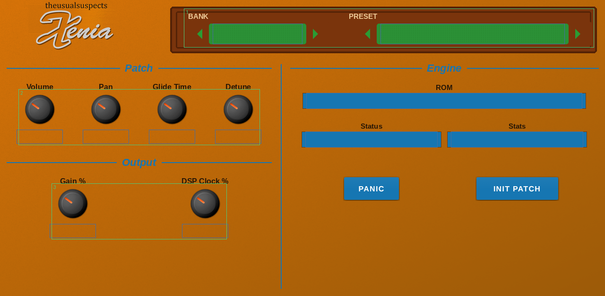

# Xenia for MPC (Gen2)

An emulation of the Waldorf Microwave XT wavetable synthesizer as a native VST2 instrument for **Akai MPC Gen2** standalone devices (MPC Live III and kin:
aarch64, MPC OS 3.x), with a touchscreen skin in the look of gearmulator's Xenia plugin and Q-Link control on every page. It runs the original XT firmware on
[gearmulator](https://github.com/dsp56300/gearmulator)'s 68k and DSP56300 emulators ("Xenia" is gearmulator's name for its Microwave XT emulation).



**Status: 0.1.0, tested on one device.** Run on an MPC Live III (MPC OS 3.9.1.2) on 2026-10-27 with a real Microwave XT ROM: it loads, boots in about half a second, plays,
changes bank and preset (steppers, BANKS tiles, data wheel), all pages and Q-Link sub-pages and the option popups work, and the DSP thread uses about 35% of one core with no
dropouts. Gen1 devices and the Force are not supported (the emulator's
JIT has no 32-bit ARM backend). One part in Multi mode (the XT's power-on state): the multi, wave editor and Global menu are not exposed.

*Xenia is an independent project, not affiliated with or endorsed by Waldorf Music. "Microwave" and "XT" are the names of the instrument it emulates.*

## You need your own ROM
No ROM is included, and none may be shared. Put your own Microwave XT firmware in `xenia/roms/` inside the plugin folder: the 256 kB `.bin` image (it starts
with the bytes `C0 DE`), or its two 128 kB halves, or an OS update `.mid` next to a full ROM (the highest version wins). The plugin looks when it starts; until
it finds one the PLAY page says `No Microwave XT ROM in xenia/roms/`.

## Using it
Add *Xenia* to a plugin track. Ten pages (tabs at the bottom; MPC pages them five at a time): **PLAY** (title bar with the bank and preset steppers on the LCD,
four assignable play knobs with a target popup each, the effect, voice allocation and detune, volume, pan, output gain and DSP clock, engine status, PANIC and INIT
PATCH), **BANKS** (the two ROM banks A and B of 100 sounds, 30 sounds per page), **OSC** (oscillators 1 and 2, waves 1 and 2, wavetable and its quality, mixer),
**AMP & ARP** (amplifier, glide, arpeggiator), **FILTER** (filters 1 and 2, filter and amp envelopes), **ENV & LFO** (free envelope, both LFOs), **WAVE ENV** (the
eight-stage wave envelope and its loops), **MOD** (four modifiers and the modulation delay), **SLOTS 1-8** and **SLOTS 9-16** (the modulation matrix).
Every four Q-Links form a column that MPC outlines on the page; pages with more knobs than one Q-Link set holds have sub-pages (OSC: oscillators, waves, mixer; AMP & ARP;
FILTER; ENV & LFO). The data wheel steps the preset; a MIDI program change selects a sound of the current bank (bank select 0 or 1 picks the bank). MPC's PRESET menu has
`Default`.

**DSP CLOCK %** (PLAY page) is how fast the emulated DSP runs: 100 is the real instrument's speed. Lower it only if the CPU can't keep up (the STATS readout
shows dropouts and the emulator's CPU). Measured on a Live III (2026-10-27): the DSP thread takes about 35% of one of its eight cores at 100, with no dropouts, so the
default stays 100. **GAIN %** is the output level (default 250; the XT's own output is quiet).

## Install
Build it (below) or, once a release exists, use the [MPC plugin catalog](https://sd88me.github.io/mpc-vst-plugins/) or the zip from
[Releases](https://github.com/sd88me/mpc-vst-xenia/releases): unzip, copy the folder to the device and run `sh install.sh` as root (it stops and restarts MPC and
backs up `MPC.settings`; on a Live III the writable drive is `/nvme/Synths`: `sh install.sh -t /nvme/Synths`). Then put your ROM in the plugin folder's
`xenia/roms/`.

## Building
Needs Docker, Python 3 with Pillow, and a checkout of [mpc-vst-plugins](https://github.com/sd88me/mpc-vst-plugins) (`MPC_VST`, default `~/mpc-vst-plugins`):
```
./build.sh test      # x86 engine + the wrapper's host test (ASan/UBSan)
./build.sh all       # aarch64 vst/build/aarch64/xenia.so + the skin (cross compiled in Docker)
tools/preview.sh X   # draw every skin page offline into vst/preview/X/
```
Release zip (no ROM, checked against the catalog rules): `./release.sh <version>`. `test/engine_test.cpp` boots a ROM from `<dir>/roms/` and checks notes,
presets, banks, parameters and the saved state: `build/x86/xenia_engine_test <dir> [seconds]`.

## How it is put together
`src/gearmulator/` is the vendored XT emulation (xtLib, wLib), the 68k and DSP56300 emulators and the JIT; `src/dsp/xenia_engine.cpp` runs `xt::Device` on a
thread of MPC's own process and maps it to the plugin wrapper of mpc-vst-plugins. `tools/gen_params.py` writes the parameter list from gearmulator's XT
parameter table; `tools/make_skin.py` draws the pages from the Xenia skin's parts. Details and what was changed: `src/VENDORED.md`, `docs/DEVELOPMENT.md`.

## Credits and licences
See [CREDITS.md](CREDITS.md). In short: the emulation is **[gearmulator](https://github.com/dsp56300/gearmulator) / [dsp56300](https://github.com/dsp56300/dsp56300)**
(GPL-3.0), the skin art is the **"xtDefault" skin of Xenia by theusualsuspects** (GPL-3.0), the JIT is **[AsmJit](https://github.com/asmjit/asmjit)** (zlib), the
labels are Liberation Sans (SIL OFL 1.1). Xenia is **GPL-3.0** ([LICENSE](LICENSE)). Not affiliated with or endorsed by Waldorf Music; no ROM is included.
