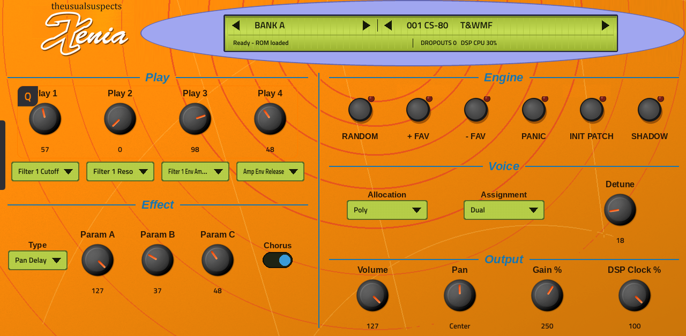
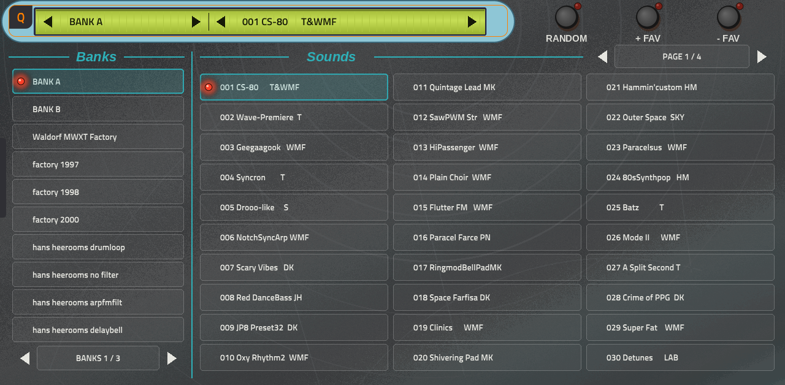
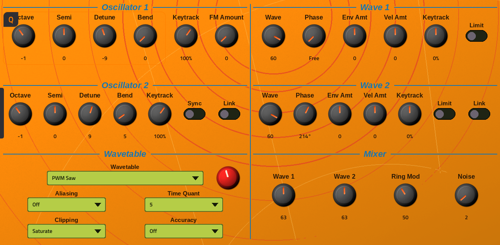

# Xenia for MPC

An emulation of the Waldorf Microwave XT wavetable synthesizer as a VST2 instrument for **64-bit Akai MPC** standalone devices (MPC Live III and others),
built on Akai's MPC Plugin SDK. It runs the original XT firmware on [gearmulator](https://github.com/dsp56300/gearmulator)'s 68k and DSP56300 emulators
("Xenia" is gearmulator's name for its Microwave XT emulation), with a native MPC screen in the look of the XT's panel and Q-Link control on every page.



**Status: 1.0.0, tested on an MPC Live III** with a real Microwave XT ROM and 20 user sound banks: it loads, plays, browses the ROM and user banks, and every
page, pick-list, key and both skins work. The Force and the 32-bit MPCs are not supported: the emulator's JIT has no 32-bit ARM backend. One part in Multi
mode (the XT's power-on state): the multi, wave editor and Global menu are not exposed.

*Xenia is an independent project, not affiliated with or endorsed by Waldorf Music. "Microwave" and "XT" are the names of the instrument it emulates.*

## What's in it
- **Ten pages**: PLAY, BANKS, OSC, AMP & ARP, FILTER, ENV & LFO, WAVE ENV, MOD, SLOTS 1-8 and SLOTS 9-16. Every block of four controls is a Q-Link group
  that the MPC outlines on the page; pages with more controls have sub-pages (press the page key again).
- **One display** on PLAY: bank and sound with step arrows, engine status and DSP load below. Tap the arrows, or turn the data wheel.
- **Two skins**, switched with the **SHADOW EDITION** key on PLAY: **Classic**, the orange XT panel with its red rings, red Cutoff and Wavetable knobs,
  and the **Shadow Edition**, the black panel with teal print. The choice applies to every Xenia on the MPC and stays until you switch again.
- **Your own sound banks**: every Microwave XT SysEx dump (`.syx`, or a `.mid` that carries one) in the plugin folder's `xenia/banks/` becomes a bank after
  ROM banks A and B (up to 64 banks of 256 sounds). The BANKS page lists ten banks a page and 30 sounds a page; BANK, PRESET and MIDI program change and bank
  select reach them too. A project saved on a user sound keeps that sound even if the bank file changes later.
- **RANDOM** picks a random sound from every loaded bank.
- **Favourites in MPC's PRESET list**: **+ FAV** stores the current sound with your edits (up to 64), pick it from the PRESET list on the track or from a
  pad, **− FAV** removes the favourite that is picked.
- **Projects saved with 0.1.x still load** with their sound and edits. The parameter order is unchanged, so automation and Q-Link assignments carry over;
  only BANK and PRESET now run up to 63 and 255 (for the user banks).

**DSP CLOCK %** (PLAY) is how fast the emulated DSP runs: 100 is the real instrument's speed. Lower it only if the CPU can't keep up (the display shows
dropouts and the DSP load). On a Live III the DSP thread takes about 35% of one of its eight cores at 100, with no dropouts. **GAIN %** is the output level
(default 250; the XT's own output is quiet).



## You need your own ROM
No ROM is included, and none may be shared. Put your own Microwave II or XT firmware in `xenia/roms/` inside the plugin folder: the 256 kB `.bin` image
(it starts with the bytes `C0 DE`), or its two 128 kB halves, or an OS update `.mid` next to a full ROM (the highest version wins). The plugin looks when it
starts; until it finds one the display says `No Microwave XT ROM in xenia/roms/`. Sound banks go in `xenia/banks/` (optional). The installer app's
**Your ROMs and files** step can do both for you: it checks each file before copying it (the rules are in `release/userfiles.json`).

## Install
From [Releases](https://github.com/sd88me/mpc-vst-xenia/releases):
- **`Xenia-1.0.0-mpc-sdk.zip`**: the plugin folder `sd88me - VST - Xenia`. Copy it into a `VST2 Plugins` folder on a drive of the MPC, put your ROM in
  its `xenia/roms/`, and restart the MPC. This needs MPC OS 3.10.1 or later, with **Preferences → Enhancements (Beta) → Enable Enhancements** and
  **External Plugin Support** switched on. Xenia is then listed under External VST Plugins → sd88me.
- **`Xenia-1.0.0-mpc-aarch64.zip`**: unzip, copy the folder to the device and run `sh install.sh` as root (it stops and restarts MPC and backs up
  `MPC.settings`; on a Live III the writable drive is `/nvme/Synths`: `sh install.sh -t /nvme/Synths`). It upgrades a 0.1.x install in place and keeps
  your ROM, sound banks, favourites and skin choice.

Use one of the two, not both: they are the same plugin.



## Building
Needs Docker (the aarch64 cross compiler image is built on first use), Python 3 with Pillow, a checkout of Akai's MPC Plugin SDK (`MPC_SDK`, default
`~/mpc-plugin-builder-sdk`) and of [mpc-vst-plugins](https://github.com/sd88me/mpc-vst-plugins) (`MPC_VST`, for `wrapper/engine.h`):
```
./build-sdk.sh          # the plugin folder build/sdk/"sd88me - VST - Xenia" (no ROM)
./build-sdk.sh test     # the offline host test (ASan/UBSan, needs your ROM in ./roms) and the SDK's host_sim
./build-sdk.sh beta     # "Xenia 2 Beta" (its own uid), to install next to the release while testing
tools/package.sh        # the release: tests, build, dist/Xenia-<ver>-mpc-aarch64.zip and -mpc-sdk.zip, SHA256SUMS
tools/make_tui.py --preview   # the skin, and drawings of every page in docs/skin-preview/
```
`tests/host_test.cpp` drives the plugin as an MPC would: identity and parameter order, sound, every kind of parameter, RANDOM, favourites, user banks, the
skin switch, a state round trip, a project chunk saved by 0.1.2 (`tests/make_legacy_chunk.sh` builds 0.1.2 to make it) and a 48 kHz host.

## How it is put together
`src/gearmulator/` is the vendored XT emulation (xtLib, wLib), the 68k and DSP56300 emulators and the JIT; `src/dsp/xenia_engine.cpp` runs `xt::Device` on a
thread of MPC's own process, reads the user banks and caches the ROM's sound names. `src/XeniaPlugin.cpp` is the plugin on the SDK's `mpc::Plugin`: the
parameter table (`tools/gen_sdk_params.py` from `params.lock`, whose order is frozen and only ever appended to), the saved state, favourites and the skin
switch. `tools/make_tui.py` draws both skins from the 1.x page art into one `TUI.json`. Details: `docs/PLAN-SDK-PORT.md`, `src/VENDORED.md`,
`docs/DEVELOPMENT.md`.

## Credits and licences
See [CREDITS.md](CREDITS.md). In short: the emulation is **[gearmulator](https://github.com/dsp56300/gearmulator) / [dsp56300](https://github.com/dsp56300/dsp56300)**
(GPL-3.0), the skin art is the **"xtDefault" skin of Xenia by theusualsuspects** (GPL-3.0), the JIT is **[AsmJit](https://github.com/asmjit/asmjit)** (zlib),
the plugin framework is **Akai's MPC Plugin SDK** (MIT), the fonts are Liberation Sans and Titillium Web (SIL OFL 1.1). Xenia is **GPL-3.0**
([LICENSE](LICENSE)). Not affiliated with or endorsed by Waldorf Music; no ROM is included.
